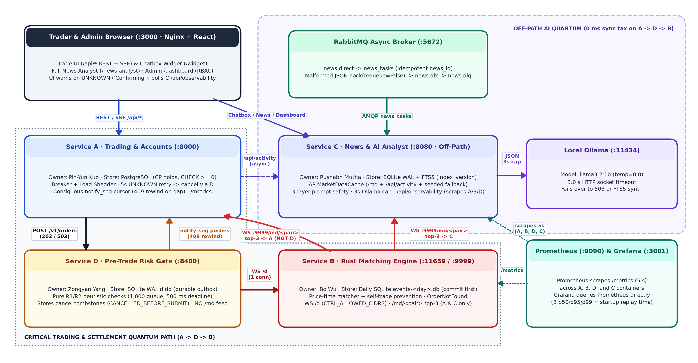

# LAME Architecture Report — Simulated Spot Exchange & AI Market Analyst

**COMP41720 Distributed Systems · Option A (Traditional Distributed System + AI Component)**
**Group:** Pin-Yun Kuo (`A`) · Bo Wu (`B`) · Rushabh Mutha (`C`) · Zongyan Yang (`D`) · **Date:** November 2026

---

## 1. Requirements, Constraints & Architectural Boundaries

**LAME** is a containerized spot exchange for crypto pairs (`BTC-USDT`, `ETH-USDT`) and multi-market reference instruments that combines a strongly consistent trading engine with an off-path generative AI market analyst (`Ollama llama3.2:1b` RAG). Running completely offline via `docker compose up --build`, it satisfies four load-bearing constraints:

1. **Zero Overdraft & Matching Finality:** Spot holds in `Service A` cannot be overdrawn (`CHECK (available >= 0)`). Once an order enters `Service B`, fills are final — so unvetted self-trading or wash-trading orders must be rejected **before** reaching `B`, and ambiguous timeouts must **never** optimistically release held funds.
2. **Deterministic Replay vs. Probabilistic AI:** `B`'s matching engine and `D`'s risk rules (`R1` self-trade, `R2` wash-trade) must replay deterministically bit-for-bit across crashes (`events-<day>.db`, `d.db`). Conversely, `Service C`'s LLM inference is probabilistic and slow (`0.4–3.0+ s`) and processes untrusted news/user text.
3. **Resilience Under Crash & Overload:** `A → D → B` fails closed when risk control is unavailable and sheds load at `A` when tail latency breaches budget, while `C` or `Ollama` failures add **0 ms** and **0 errors** to the trading path.
4. **End-to-End Observability:** Every service exports Prometheus `/metrics`; a centralized Prometheus + Grafana stack (`:9090` / `:3001`) and unified React `/dashboard` surface request rate, errors, `p50/p95/p99` latency, and AI token cost.

*Explicit non-goals:* real fiat custody, leverage/margin liquidation (deferred stretch goal), live internet order routing, and AI-based trade execution or investment advice.

---

## 2. System Architecture, Styles & Service Quanta (C4 View)

LAME is decomposed into **four independent architecture quanta** plus shared infrastructure — each service answers one business question and owns its private persistent store with **zero shared-database coupling**. `Service A` and `Service C` sit side-by-side behind the unified Trader/Admin React UI (`:3000`), while `Service B` streams `/md/<pair>` top-3 snapshots directly to **`A` and `C` only (never to `D`)**:

**Architectural styles & coordination (3C Cube):** On the critical order path, `A` uses **ACID/CP local transactions** for fund holds and communicates with single-instance `D` (orchestrated state machine + outbox) and single-writer `B` (sequential per-pair matchers fed by one journal thread), deliberately avoiding the forbidden *"Async + Atomic + Choreographed"* distributed-2PC quadrant. Settlement follows an **at-least-once ordered notification log** (`notify_seq`) with `SELECT ... FOR UPDATE` cursor locking. Meanwhile, `Service C` acts as an **AP CQRS analytical read quantum** via RabbitMQ + passive WebSocket consumption.

| Component / Quantum | Primary Role | Data Store & Consistency | Wire Contract & Port |
| --- | --- | --- | --- |
| **A: Trading & Accounts** | Auth (Argon2id/JWT), balances, holds, order lifecycle, candles, React shell | PostgreSQL (**CP** holds; eventual settlement & SSE w/ `Last-Event-ID`) | HTTP/SSE via Nginx (`:3000` → `:8000`), WS client to `B` `/md/<pair>` |
| **D: Risk Control** | Pure deterministic `R1` (self-trade heuristic) & `R2` (wash trade); cancel tombstones (`CANCELLED_BEFORE_SUBMIT`); command proxy & outbox | SQLite WAL (`d.db`); fail-closed gate, ordered outbox | HTTP `:8400` (`A`), single WS client to `B` `:11659/d` (no `/md` feed) |
| **B: Matching Engine** | Integer tick/lot price-time matching, **in-matcher self-trade prevention** (`book.rs`), `OrderNotFound` on unknown cancels, write-ahead journal & crash replay | Daily SQLite `events-<day>.db`; total `(day, seq)` order (committed before publish) | WS `:11659/d` (source CIDR allow-list `CTRL_ALLOWED_CIDRS`), `:9999/md/<pair>` (`A` & `C`) |
| **C: News & AI Analyst** | News replay + DLQ, FTS5 search, grounded RAG, `/api/observability` | SQLite WAL+FTS5 (`news_c.db`), **AP** `MarketDataCache` (`/md` + `/api/activity` + seeded fallback) | HTTP `:8080`, AMQP `5672`, Ollama `11434`, WS client to `B` `/md/<pair>` |

---

## 3. Consistency, Failure Handling & Resilience (With Observed Evidence)

Because `D`'s `POST /v1/orders` returns `202` before matching finishes, a timeout leaves order fate ambiguous. Per **ADR-002**, `A` transitions timed-out sends to `UNKNOWN` and keeps funds held, resending the same `order_id` (`5 s` `RESEND_WINDOW` threshold before switching from retries to cancellation) and issuing a `cancel` (**tombstoned by `D` if it never received the order**, so any later arrival is rejected as `CANCELLED_BEFORE_SUBMIT` and never reaches `B`; `B` itself stores no tombstones and returns `OrderNotFound` for an unknown order). `D` records every `(decision_no, features_seq, rule_version)` atomically before writing to `B`, while `B` commits every command, `OrderEvent`, and `Trade` to `events-<day>.db` before publishing outbound `/d` events and refuses startup if crash-replay outputs disagree (`match_engine/doc/status.md`).

On market data (`/md/<pair>`), `B` independently broadcasts self-contained top-3 snapshots (`bids`, `asks`, `last_price`, `last_ms`) to **`A` and `C` (not `D`)**. Rather than sending a bespoke `"heartbeat": true` flag, `B` re-sends the current snapshot with the **same `last_ms`** every `1 s` when the book is quiet. Both `A` and `C` discard only strictly older timestamps (`ts_ms < existing`), treat equal `last_ms` resends as liveness signals, reset watermarks on reconnect, and flag staleness after `3.0 s` of silence. Note that `C` also accepts simulated/live prices through `/api/activity` and seeds `simulated_fallback` snapshots on startup, so `data_freshness_seconds` alone indicates cache recency rather than strictly proving `service_b_ws` provenance (`source` identifies provenance). `C` sits completely off the critical trading path (`0 ms` sync delta on `A → D → B`), and `3.0 s` separately bounds Ollama's HTTP socket timeout.

**Measured Failure & Benchmark Evidence (`service_a/tools/measure_local.py`, `service_d/tools/loadtest.py`, `service_c` checks):**

| Injected Fault / Benchmark | System Behaviour Observed | Measured Evidence |
| --- | --- | --- |
| **Baseline Order Flow** (`40` orders, Windows laptop) | `A → D → B → D notify → A` live flow + `26` E2E checks (`local_e2e.py`) | `POST` p50 `160.4 ms` / p95 `215.9 ms`; placement→`PROCESSING` p50 `227.6 ms` / p95 `505.1 ms`; `29–46 notify/s` (`~10–15 trades/s`) |
| **Standalone Gate & Compose Throughput** (`service_d/tools/loadtest.py`) | `D` with fake `A` and `B` in-process (includes `D` HTTP & SQLite writes, excluding `B`/network); plus live Compose with real `B` | Local loadtest decision `p99`: `1 ms` @ `200 orders/s`, `2 ms` @ `1,000 orders/s`; real-`B` Compose @ `200 orders/s`: `202` reply `p99` `7 ms`, decision `p99` `2 ms`, `0` timed-out orders |
| **Kill Service D** *(18 Nov, local processes on Windows)* (`D` unavailable on path) | New orders rejected `503 SYSTEM_BUSY` with `0` held USDT; circuit opens after `5` consecutive failures (refused connections, timeouts or `RISK_UNAVAILABLE`) | First `5` fails `580–598 ms`; breaker-open fails `15–18 ms`; `D` ready `4.15 s` after restart; `A` accepting at `8.99 s` (`15.1 s` total recovery) |
| **Kill / slow `D`, stop `B` under steady traffic** *(20 Nov, compose · `fault_demo.py --compose`, 503 orders)* | `D` down: `SYSTEM_BUSY`, `0` held, Grafana shows `D` down on *Service Up* and `A`'s refusals rising *(on 20 Nov the live page wrongly showed `A`, `B`, and `D` all offline — fixed later)*; `D` slowed to `2 s`: `A` sheds load, `D` rejects `RISK_TIMEOUT` (fails closed); `B` down: `NO_FRESH_PRICE` (`400` in 20 Nov run; `503` on current HEAD `46787cf`) | Refusals in `24 ms` (median) once `D` is known down; accepting `1.2 s` after `D` ready; shedding `4.8 s` after slow-down; `B` refusals after `2.6 s`, accepting `6.3 s` after restart |
| **Consistency shown working** (`consistency_demo.py`) | Double submit → one order, one hold; skipped `notify_seq` → `409` → outbox rewind; `A` killed with `3` outcomes in `D`'s outbox → drained after restart; `D` frozen `3 s` / `8 s` → `UNKNOWN` held, then accepted / compensated by cancel | Books check over `253` orders: ledger = balances, holds = open orders, assets conserved, `A` cursor = `D` outbox head (`730`) — all deviations `0` (`docs/submission/fault_injection.md`) |
| **Drop Notification / Stale Feed / Crash** | `409 expected_seq` rewind; `NO_FRESH_PRICE` after `3 s`; `UNKNOWN` resend reconciliation | Verified via `220` Service A tests (`test_concurrent_holds_never_overdraw`) + Service D test suite (`test_replay.py`, `test_flow.py`) |
| **Poison News / Prompt Injection / Ollama Stall** | Poison JSON routed `nack(requeue=False)` to `news.dlq`; injections/empty hits short-circuit (`0` tokens); `3.0 s` HTTP timeout prevents worker pinning; peer scrape timeout isolated (`F5`) | `31/31` Service A↔C integration checks + `9/9` Service C unit tests + `6/6` Service C fault scenarios (`F1–F6`) pass; `C` sits off-path (`0 ms` sync tax when `C` stops) |

*Note: The two D-kill rows differ by environment: on Windows each attempt waits for the `0.5 s` connect timeout, while in compose the connection is refused at once.*

**Scaling bottleneck honestly identified:** `A` applies `D`'s notifications one DB transaction at a time (`18–31 ms`), capping settlement around `10–15 trades/s` on a laptop. Batching contiguous `notify_seq` events in a single transaction preserves strict order while multiplying throughput.

---

## 4. Trade-Off Analysis (Week 2 & Week 10 Method)

Following the 3-step trade-off method (*entangled dimensions → coupling points → scenario pricing*), three foundational trade-offs shaped LAME without relying on invented weighted scores:

### 4.1 Hold Funds on Timeout vs. Optimistic Release (`ADR-002`)
- **Entangled Dimensions & Coupling:** *Fund Liquidity / UX* vs. *Spot Ledger Invariant (`available >= 0`)* across `A`'s PostgreSQL balance lock and `D/B`'s async execution boundary.
- **Concrete Scenarios:** If `A` releases holds after a `2 s` HTTP timeout to `D`, liquidity unlocks immediately — yet an order already accepted by `B` can still fill against re-spent funds, violating `CHECK (available >= 0)` and halting settlement globally. Holding until `D`'s notification (`UNKNOWN` → resend/cancel tombstone in `D`) freezes only the funds of orders already in flight while `D` is down; new orders are refused before anything is held. With `D` killed for about `49 s` on 20 Nov, `A` accepted again `1.2 s` after `D` was ready, and an `8 s` pause turned the in-flight order into a cancel whose hold returned `1.2 s` after `D` came back.
- **Verdict:** Chose **hold-until-notification**; automated recovery dominates corrupt ledger repair. *(Three things made worse: `UNKNOWN` UI confusion ("Confirming"), temporary fund lock on in-flight orders during outages, and extra reconciliation state tests.)*

### 4.2 Synchronous Fail-Closed Risk Gate vs. Async Post-Trade or Shed-to-R1 (`ADR-001`)
- **Entangled Dimensions & Coupling:** *Manipulation Prevention + Replay Determinism* vs. *Availability + Tail Latency* across the single `A → D → B` path.
- **Concrete Scenarios:** Async post-trade checking removes `D` from order `p99`, but self/wash fills settle irreversibly before detection. Weakening `D` under overload by dropping cross-account `R2` while keeping `R1` boosts availability precisely when an attacker can flood the gate to sneak wash trades through. Instead, keeping `D` fast (`1–2 ms` decision `p99` locally / `2 ms` decision `p99` in Compose; in-matcher self-trade prevention also backstops `B`) and shedding new orders at `A` preserves both rules.
- **Verdict:** Chose **fail-closed `R1`+`R2` gate + `A` load shedding**. *(Makes worse: total unavailability of new orders, cancels, and settlements whenever `D` stops; conservative crossing-limit false positives; extra hop latency.)*

### 4.3 Off-Path FTS5 AI Analyst vs. Embedded RAG or Vector Embeddings (`ADR-003`)
- **Entangled Dimensions & Coupling:** *Explanation Richness + Low Container Count* vs. *Trading Latency Isolation + Reproducibility + Trust Containment*.
- **Concrete Scenarios:** Embedding RAG directly inside `A` removes a container and CORS surface, but mixes non-deterministic `0.4–3.0+ s` LLM work, prompt-injection payloads, and news surges into the balance-hold service. Likewise, dense vector embeddings add separate model inference latency, VRAM overhead, and drift across index rebuilds compared to **SQLite FTS5 BM25** inside a single atomic `news_c.db` (`index_version`).
- **Verdict:** Chose **off-path Service C + deterministic FTS5 BM25**. *(Makes worse: eventual consistency up to `3.0 s` snapshot lag + news replay delay; extra RabbitMQ/Ollama containers; keyword sensitivity mitigated via ticker normalization.)*

---

## 5. AI Components and Their Architectural Implications

Integrating local `Ollama (llama3.2:1b)` behind `Service C` introduces four distinct architectural failure modes highlighted in COMP41720 (**Weeks 7, 8, 10** — *4 AI Axes & 5 Omission Clusters*):

1. **Autonomy vs. Safety & Trust Boundary (Tenancy/Trust Cluster):** Both user queries and external scripted/fetched news feeds are untrusted text capable of prompt injection or fabricated advice. `Service C` enforces a three-layer defence (`security.py` + `rag.py`): (a) regex pre-screening blocks injection overrides and investment-advice requests pre-LLM (`REJECTED_UNSAFE`), and sanitizes embedded injections on ingestion; (b) retrieved news is wrapped inside `<retrieved_evidence id="...">` XML delimiters explicitly labelled untrusted data; and (c) post-generation citation validation checks whether each cited `news_id` was retrieved from FTS5 and strips any unretrieved ID.
2. **Determinism vs. Creativity (Change Cluster):** Exchanges demand traceable evidence. `Service C` pins `temperature = 0.0`, passes `LLMStructuredOutput` JSON Schema via Ollama's constrained `format` parameter, stamps every reply with FTS5 `index_version`, and runs a deterministic BM25 gate (`bm25_min_score = 0.05`) that short-circuits to `INSUFFICIENT_EVIDENCE` when relevant news is absent.
3. **Accuracy vs. Latency (Failure & Invalidation Clusters):** LLM brownouts (*"slow is worse than dead"*) can exhaust FastAPI worker pools. `C` enforces a `3.0 s` HTTP socket timeout on Ollama calls, serves either an honest `HTTP 503` or configurable deterministic synthesis fallback on timeout, and surfaces `data_freshness_seconds`, `news_freshness_seconds`, `is_stale`, and `source` (`service_b_ws` vs `/api/activity` / `simulated_fallback`) on every answer.
4. **Spend Is Load (Cost Cluster):** Even local models consume bounded CPU/GPU budget, and cloud parity requires explicit unit economics. `Service C` short-circuits empty/unsafe queries before invoking Ollama and exports `lame_c_tokens_total{type="prompt|eval"}`, `lame_c_estimated_token_cost_usd` (`$0.10 / 1M` input, `$0.30 / 1M` output reference baseline alongside `$0.00` local Ollama bill), and `lame_c_tokens_saved_by_gates_total` (`total_refusals * 350`, which in `metrics.py` also includes post-inference `sufficient_evidence=false` refusals).

---

## 6. Cost, Deployment & Observability View

Everything launches via one root `docker-compose.yml` spanning dedicated volumes per quantum (`service_a_pgdata`, `service_b_data`, `service_d_data`, `service_c_data`, `ollama_models`, `prometheus_data`, `grafana_data`). Running `llama3.2:1b` locally eliminates per-token cloud bills during bursty load tests at the cost of local container RAM (`~2 GB` Ollama, `512 MB` capped for `service-b`).

Telemetry serves two complementary views: **`Grafana (:3001)` queries `Prometheus (:9090)`** (which scrapes `/metrics` from all four services every `5 s` into the `LAME System & AI Observability` dashboard), while **`React /dashboard` queries Service C's `/api/observability` aggregator** directly:
- **Traffic & Errors:** Per-service `req/s`, cumulative counts, HTTP `≥ 500` server errors (`4xx` tracked separately as `client_4xx`), `A` circuit/shedding (`lame_a_circuit_state`, `lame_a_shedding_active`), `B` bad frames/overflows & `OrderEvent` count, `D` `503` refusals & `decision="REJECTED"`, and `C` RabbitMQ `news.dlq` depth.
- **Latency:** `A` HTTP & order-completion histograms, `D` gate decision histograms, `C` end-to-end chat & pure LLM inference histograms (`B` omits per-order timers per D23 to protect hot-path overhead; its displayed `p50`/`p95`/`p99` values in `/api/observability` all report the same startup replay duration, `lame_b_replay_duration_seconds`).
- **AI Telemetry:** Prompt/eval token counts, estimated equivalent & direct USD token spend, token savings estimate, refusal rate breakdown, and stripped unretrieved citations.
